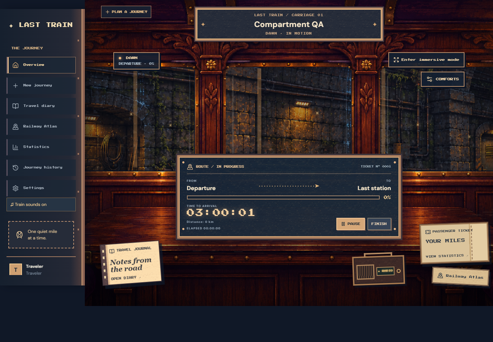
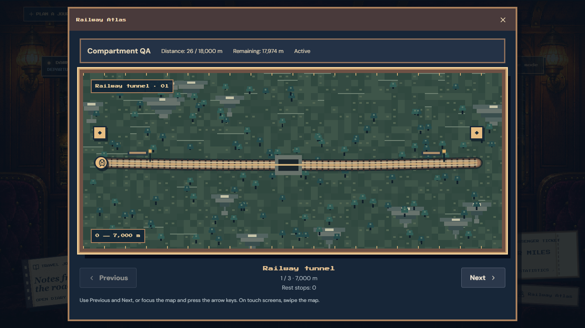
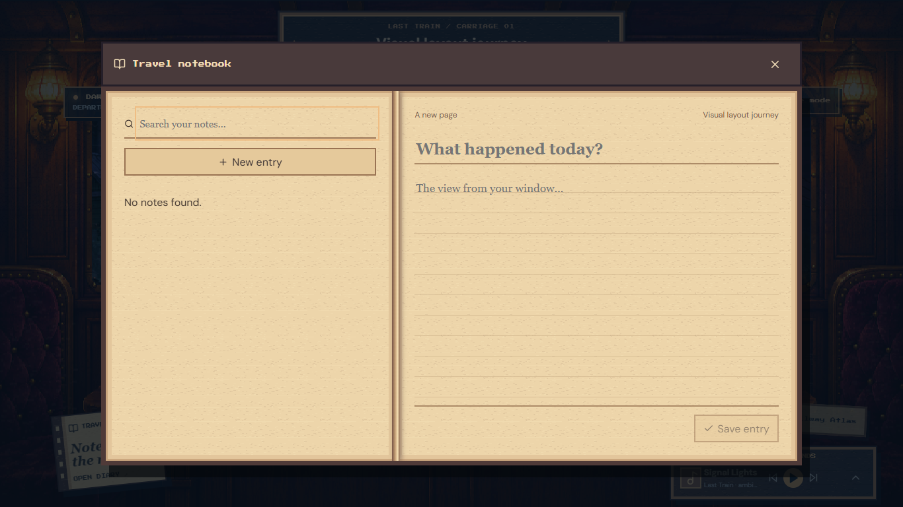
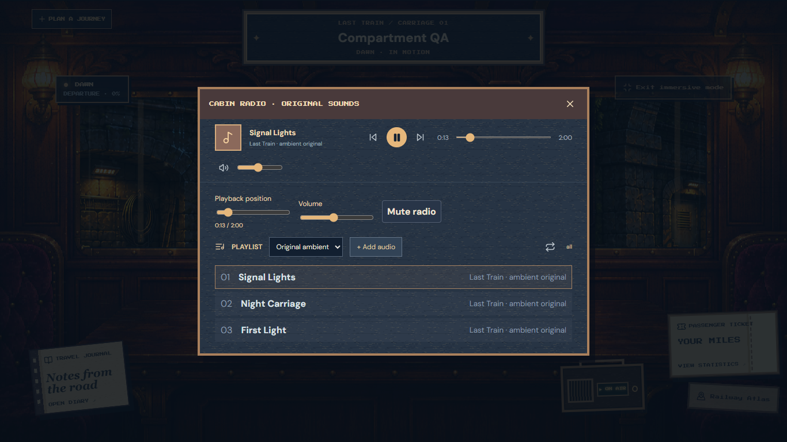

# LAST TRAIN

### A quieter way to make time feel like a journey.

**In the end… it matters how far the train has traveled.**

 

 

**[Download for Windows](https://github.com/count-rzy/diamondtime-train/releases/tag/v1.0.0-exp.1)** &nbsp; · &nbsp; [What’s included](#the-journey) &nbsp; · &nbsp; [Screenshots](#a-look-inside) &nbsp; · &nbsp; [Development](#for-developers)

 

> **Experimental pre-release.** Last Train v1.0 EXP is an early release and some workflows may still have bugs. Create a backup before major updates. In-app backup restoration is not yet supported.

## The journey

Last Train gives focused time a sense of place. Choose a route and a duration; work moves the train forward, planned breaks become station stops, and the timer ends with an arrival. A warm-lit pixel-art carriage and changing landscapes make the passing minutes visible, while your diary keeps the moments worth remembering.

It is a small local companion for work, rest and reflection — one quiet mile at a time.

## A look inside

*The carriage: set out, watch the landscape change, and arrive when your session is complete.*

 

<table>
<tr>
<td width="50%" align="center"> Follow the route in the Railway Atlas</td>
<td width="50%" align="center"> Keep a travel diary along the way</td>
</tr>
<tr>
<td colspan="2" align="center">  Settle in with the cabin radio and train ambience</td>
</tr>
</table>

## Along the way

| **Journeys** | **A living railway** |
|:--|:--|
| Set a focus duration, add planned rest stops, and follow progress to arrival. Review completed trips in journey history. | An illustrated carriage frames changing scenery, station events and an interactive Railway Atlas that follows your route. |
| **Diary & statistics** | **Sound & atmosphere** |
| Write and search diary entries beside your journeys. See your accumulated time and trip history in statistics. | Play the built-in radio, add supported local audio, and tune the independently controlled train ambience. |
| **Your preferences** | **Your local profile** |
| Use Russian or English, and adjust display, motion, weather and sound preferences. | Journeys, notes, settings and imported audio stay in the local profile. Create a ZIP backup or export journeys and diary from Settings. |

## Windows portable edition

The experimental download is a Windows x64 portable ZIP. **Python, Node.js and VS Code are not needed** to use it.

1. [Download the Windows ZIP](https://github.com/count-rzy/diamondtime-train/releases/tag/v1.0.0-exp.1) from the experimental release.
2. Extract the entire archive to a writable folder; keep the EXE files, `_internal` folder and other packaged files together.
3. Double-click **Start Last Train.exe**. The application opens in your browser and runs locally on your computer.
4. When you are finished, double-click **Stop Last Train.exe**. Closing the browser tab alone may leave the local server running.

Your portable profile lives under `%LOCALAPPDATA%\LastTrain`, outside the program files, so replacing the application folder preserves it. Make a backup before major updates and keep important copies somewhere safe. **Restoring a backup from Settings is not supported yet.** The existing `restore.bat` belongs to the source project and is not included in the portable ZIP; see [portable data notes](docs/PORTABLE-WINDOWS.md) before migrating source data.

## Technology

`React` &nbsp; · &nbsp; `Vite` &nbsp; · &nbsp; `JavaScript` &nbsp; · &nbsp; `Django` &nbsp; · &nbsp; `Django REST Framework` &nbsp; · &nbsp; `Waitress` &nbsp; · &nbsp; `SQLite` &nbsp; · &nbsp; `PyInstaller`

The browser interface is built with React and Vite. A local Django API and Waitress server handle application requests; SQLite stores the profile. The Windows portable edition packages the runtime with PyInstaller.

## For developers

On Windows, install Python 3.12–3.14 and Node.js 22 or 24 LTS. From the repository root, run `setup.bat` to install dependencies and build the frontend, then `start.bat` to run the local app; use `stop.bat` to stop it. Initial dependency setup needs internet access. Normal local use does not.

See [portable build and data notes](docs/PORTABLE-WINDOWS.md), [local edition engineering notes](docs/LOCAL-EDITION.md), and the [development changelog](CHANGELOG.md).

## Credits

**Created by COUnT (count-rzy).**

**Special thanks to Sonya (Ryuko)** — for her contributions, guidance, patience, and for helping me grow as a developer. Some journeys begin long before the train leaves the station.

The stable v1.0 documentation will include a longer acknowledgement, as recorded in the [stable documentation plan](docs/STABLE-1.0-DOCUMENTATION-TODO.md).

---

*In the end… it matters how far the train has traveled.*

